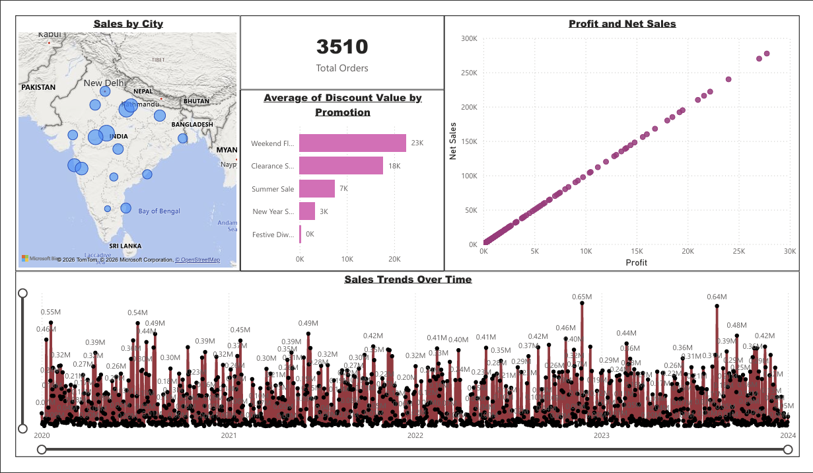
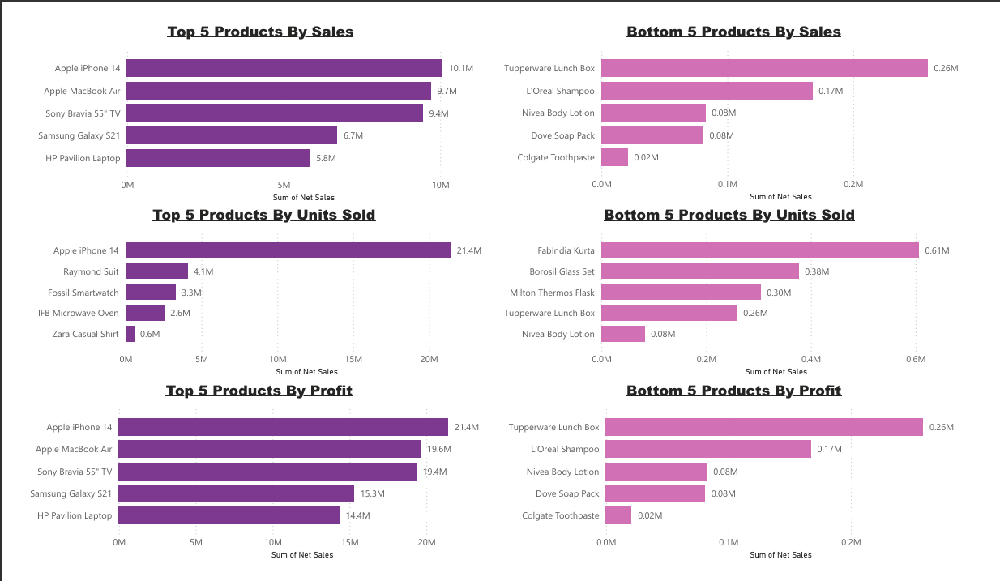
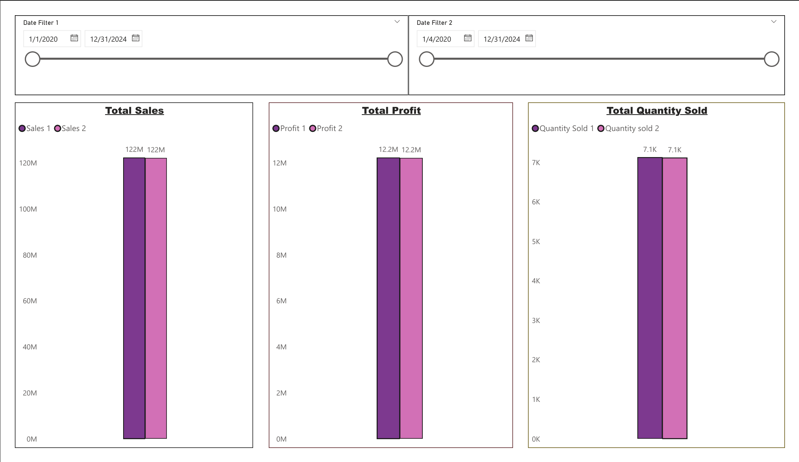

# 📊 Retail Sales Analytics Dashboard — Power BI

> An end-to-end sales intelligence dashboard built with Power BI, 
analyzing retail performance across Indian cities from 2020 to 2024.

---

## 📌 Project Overview

This project is a multi-page interactive Power BI dashboard designed 
to help retail decision-makers track sales trends, evaluate product 
performance, measure promotion effectiveness, and compare performance 
across different time periods.

The dataset covers **3,510 orders** placed across multiple Indian 
cities, spanning **4 years (2020–2024)**, with filters for customer 
name, product, promotion type, and date range.

---

## 🔍 Business Questions Answered

- ✅ Which products are driving the most revenue and profit?
- ✅ How have sales trended month-over-month across 4 years?
- ✅ Which promotions offer the highest average discount value?
- ✅ How does one time period's performance compare to another?
- ✅ Which cities have the highest order volume?

---

## 📈 Key Metrics (Full Date Range)

| Metric | Value |
|---|---|
| 📊 Total Sales | ₹122 Million |
| 📦 Total Units Sold | 7,100 |
| 📋 Total Orders | 3,510 |
| 📉 Total Profit | ₹12.2 Million |

---

## ⭐ Key Insights

### 👍 Top 5 Products by Net Sales
| Rank | Product | Net Sales |
|---|---|---|
| ⭐⭐⭐ | Apple iPhone 14 | ₹10.1M |
| ⭐⭐ | Apple MacBook Air | ₹9.7M |
| ⭐⭐ | Sony Bravia 55" TV | ₹9.4M |
| ⭐ | Samsung Galaxy S21 | ₹6.7M |
| ⭐ | HP Pavilion Laptop | ₹5.8M |

### 📉 Bottom 5 Products by Net Sales
| Rank | Product | Net Sales |
|---|---|---|
| ☑️ | Colgate Toothpaste | ₹0.02M |
| ☑️ | Dove Soap Pack | ₹0.08M |
| ☑️ | Nivea Body Lotion | ₹0.08M |
| ☑️ | L'Oreal Shampoo | ₹0.17M |
| ☑️ | Tupperware Lunch Box | ₹0.26M |

### 🏷️ Promotions by Average Discount Value
| Promotion | Avg. Discount |
|---|---|
| Weekend Flash Sale | ₹23,000 |
| Clearance Sale | ₹18,000 |
| Summer Sale | ₹7,000 |
| New Year Special | ₹3,000 |
| Festive Diwali | ₹0 |

---

## 🗺️ Geographic Distribution

📌 Sales mapped across multiple major Indian cities using bubble maps.

📌 Larger bubbles = higher order concentration.

📌 Highest volumes in northern and central India.

---

## ⚙️ Tools & Technologies

| Tool | Purpose |
|---|---|
| 📊 Power BI Desktop | Dashboard creation and visualization |
| 📋 Microsoft Excel | Raw data source and preparation |
| 🔧 DAX | Custom measures and calculated columns |
| ⚙️ Power Query | Data transformation and cleaning |

## 🖥️ Dashboard Screenshots

### Overview — Sales by City, Trends & Profit

### Product Performance — Top & Bottom Products

### Period Comparison — Sales, Profit & Quantity

---

## How to Open the Dashboard

- ➡️ Download [Power BI Desktop](https://powerbi.microsoft.com/desktop/)
- ➡️ Clone or download this repository
- ➡️ Open Sales data Project 1.pbix
- ➡️ Use filters to explore the data

---

## What I Learned

- ✅ Building multi-page interactive dashboards in Power BI
- ✅ Writing DAX measures for profit margins and net sales
- ✅ Designing user-friendly slicers and filter panels
- ✅ Using scatter plots, maps, bar charts and trend lines
- ✅ Comparing time periods using dual date filter slicers

---

## Author

**Luck** — Aspiring Data Analyst | Computer Science Student
Austin, Texas
➡️ [GitHub Profile](https://github.com/luck-page)
